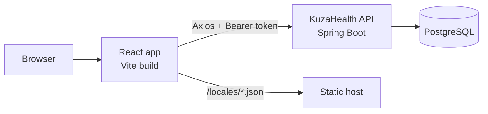

<div align="center">


# KuzaHealth Frontend

**A digital register for maternal and child care.** Health workers record pregnancies, visits and vaccinations, and see which mothers and babies are due for care.

[](https://react.dev)
[](https://www.typescriptlang.org)
[](https://vitejs.dev)
[](https://tailwindcss.com)

[Quick start](#quick-start) · [Features](#features) · [Configuration](#configuration) · [Development](#development)

</div>

---

This is the browser app for KuzaHealth. It has a public landing page, sign-in screens, and a separate workspace for each role: health workers, super admins and data analysts. All data comes from the [KuzaHealth backend](https://github.com/tuyishimehope/kuzehealth-backend), a Spring Boot API that this repo talks to over HTTP.

> [!IMPORTANT]
> You need a running KuzaHealth backend and an account on it to use anything past the landing page. This repo has no mock API or demo accounts.

## Quick start

```bash
git clone https://github.com/tuyishimekyrie/kuzahealth.git
cd kuzahealth
npm ci
echo "VITE_API_BASE_URL_DEV=http://localhost:8080" > .env.local   # your backend's address
npm run dev
```

Open `http://localhost:5173`. If that port is taken, Vite picks the next free one and prints it.

> [!NOTE]
> The backend must allow requests from the frontend's origin (CORS). If Vite moves to another port, such as `5174`, the backend may reject sign-in until you allow that origin too.

## Features

| | |
| --- | --- |
| **Landing page** | Explains the product with a sample "due this week" register, how it works and a feature overview. |
| **Sign-in and accounts** | Email and password sign-in that sends each role to its own dashboard. Also sign-up, forgot password and reset password. |
| **Health worker workspace** | Dashboard and analytics. Register and view mothers, nutrition info, register and view infants, infant vaccinations, schedules, appointments, reports, settings and profile. |
| **Super admin workspace** | Dashboard. Manage health workers, mothers, data analysts and users. Facilities, reports, audit, admin logs and settings. |
| **Data analyst workspace** | Dashboard, health workers, mothers, schedules, facilities, reports and settings. |
| **Three languages** | English, Kinyarwanda and French, with a language picker. English is the fallback for any missing text. |
| **One color system** | Every color comes from one file, so a rebrand is a single edit. See [Theming](#theming). |

## Architecture



The app is a single-page React app served as static files. Sign-in posts email and password to `POST /api/v1/auth/login`. The token that comes back is stored JSON-encoded in `localStorage` under `token`. The shared Axios client in [`src/utils/axiosInstance.ts`](src/utils/axiosInstance.ts) adds it as `Authorization: Bearer …` to every request. Translations load from the same static host at runtime.

> [!WARNING]
> Route protection in the browser is minimal. Only the health worker area checks that a token exists. The backend is what actually enforces who can see what.

<details>
<summary><b>Project structure</b></summary>

<br />

```text
kuzahealth/
├── public/
│   ├── favicon.svg
│   └── locales/{en,rw,fr}/translation.json
├── src/
│   ├── components/
│   │   ├── landing/         # Landing page sections
│   │   ├── auth/            # Shared side panel for sign-in screens
│   │   ├── shell/           # AppShell: sidebar and top bar for all workspaces
│   │   ├── common/          # Logo, Button and other shared pieces
│   │   ├── ui/              # shadcn-style primitives
│   │   └── HealthWorker/    # Health worker widgets (map, charts, modal)
│   ├── layouts/             # One layout per role, each built on AppShell
│   ├── pages/               # auth/, HealthWorker/, superadmin/, data-analyst/, Home.tsx
│   ├── routes/              # Root router plus one route file per area
│   ├── styles/tokens.css    # Design tokens: the single source of colors
│   ├── theme/               # Token bridge for JS, Mantine and MUI themes
│   ├── utils/               # Axios client and helpers
│   ├── i18n.ts              # Language setup
│   └── main.tsx             # App entry: theme, React Query and router
├── tailwind.config.js       # Maps Tailwind color names to the tokens
├── vite.config.ts           # React plugin and the @/ → src/ alias
└── netlify.toml             # SPA fallback to index.html
```

</details>

<details>
<summary><b>Routes</b></summary>

<br />

| Route | Page |
| --- | --- |
| `/` | Landing page |
| `/auth/signin` | Sign in |
| `/auth/signup` | Create an account |
| `/auth/forgot-password` | Request a password reset |
| `/auth/reset-password` | Set a new password |
| `/healthworker/dashboard` | Health worker home |
| `/superadmin/dashboard` | Super admin home |
| `/data-analyst/dashboard` | Data analyst home |

The role roots (`/healthworker`, `/superadmin`, `/data-analyst`) have no index page, so link to `/dashboard` directly. The full lists are in [`src/routes/`](src/routes).

</details>

## Tech stack

| Layer | Tools |
| --- | --- |
| App | React 18, TypeScript 5, Vite 5 |
| Routing | React Router 6 (nested routes) |
| Data | Axios, TanStack Query 5 |
| UI and styling | Tailwind CSS 3, Mantine 6, MUI 7, Radix UI, Framer Motion, Lucide icons |
| Forms | React Hook Form, Zod |
| Charts and maps | Recharts, ApexCharts, Chart.js, MUI X Charts, Leaflet |
| Languages | i18next, react-i18next |
| Export | jsPDF, Papa Parse, export-to-csv, file-saver |
| Quality | ESLint 9, TypeScript |

## Configuration

| Variable | Default | Description |
| --- | --- | --- |
| `VITE_API_BASE_URL_DEV` | none | The backend's address, for example `http://localhost:8080`. Leave off `/api/v1`, because the code adds it. Used in development **and** production builds, despite the `_DEV` suffix. |

Put it in `.env.local`, which git ignores. Vite reads it when it starts and bakes it into the build, so restart `npm run dev` or rebuild after you change it. Anything prefixed `VITE_` ends up in the browser bundle, so never put secrets there.

### Theming

All colors live in [`src/styles/tokens.css`](src/styles/tokens.css) as CSS variables: color ramps from 50 to 950, plus names for each purpose such as `--primary`, `--background` and `--chart-1`. Tailwind classes (`bg-primary`, `text-muted-foreground`), Mantine, MUI and the charts all read from that file. To rebrand, edit the `primary` ramp there. Don't hard-code hex values in components. In JavaScript, use `colors` and `alpha()` from [`src/theme/colors.ts`](src/theme/colors.ts).

### Translations

Text lives in `public/locales/<lang>/translation.json` for `en`, `rw` and `fr`. Keep the keys the same in all three files. Some newer text, such as the landing page, passes English fallback text to `t()` and has no translation keys yet. To add a language, add its file and put its code in `supportedLngs` in [`src/i18n.ts`](src/i18n.ts).

## Development

```bash
npm run dev       # start the dev server with hot reload
npm run build     # type-check (tsc -b), then build to dist/
npm run preview   # serve the built dist/ locally on port 4173
npm run lint      # run ESLint
```

There's no test suite or `npm start` script. Lint and the type check in `npm run build` are the only automated checks, so also click through what you changed in the browser.

### Deploying

Set `VITE_API_BASE_URL_DEV` in the build environment, run `npm run build`, and serve `dist/` from any static host. The host must send `index.html` for unknown paths so deep links and refreshes work. [`netlify.toml`](netlify.toml) already does this on Netlify: use build command `npm run build` and publish directory `dist`. The app assumes it is served from the domain root, not a subpath.

<details>
<summary><b>Known gaps</b></summary>

<br />

| Item | State |
| --- | --- |
| `docker-compose.yml` | Has no Dockerfile to build from, and sets `VITE_BASE_URL`, which the app doesn't read. Not usable as is. |
| `.github/main.yml` | Not in `.github/workflows/`, so GitHub doesn't run it. It also targets Node 16 and uploads `build/` instead of `dist/`. |
| `npm run docs` | Points at a `typedoc.json` that doesn't exist. |
| [`documentation.md`](documentation.md) | Older notes under a previous name. Trust the code where they differ. |

</details>

<details>
<summary><b>Troubleshooting</b></summary>

<br />

| Symptom | Likely cause |
| --- | --- |
| Requests go to the frontend's own address | `VITE_API_BASE_URL_DEV` isn't set. Set it, then restart Vite or rebuild. |
| Sign-in fails with a CORS or network error | The backend isn't running or doesn't allow this origin. Check the port Vite printed. |
| Sign-in says `otp` is required | The backend is running an older build. Rebuild and restart it. |
| `401` or `403` on API calls | The token is missing or expired, or the role isn't allowed. Sign in again. |
| Errors about parsing the token | A hand-edited `token` in `localStorage`. Clear it and sign in again. |
| `/healthworker` shows an empty shell | Role roots have no index page. Go to `/healthworker/dashboard`. |
| Refresh on a deep link returns 404 | The host isn't falling back to `index.html`. |
| Translation keys show as raw text | The key is missing from that language's `translation.json`. |

</details>

## Contributing

1. Branch from `main`.
2. Run `npm run lint` and `npm run build`, and check your change in the browser, including at phone width.
3. Open a pull request with a short description and screenshots for UI changes.

## License

No license is included yet. Ask the project owner before reusing or redistributing this code.
